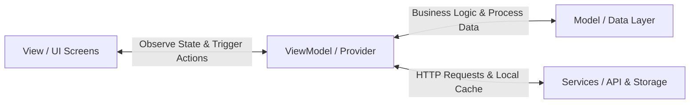

# Aplikasi Cuaca - Responsi Praktikum Flutter

Aplikasi pemantau cuaca berbasis Flutter dengan pola arsitektur **Model-View-ViewModel (MVVM)**, integrasi **Open-Meteo REST API**, manajemen state menggunakan **Provider**, dan penyimpanan lokal menggunakan **SharedPreferences**.

---

## 📋 Daftar Isi
1. [Deskripsi Singkat](#-deskripsi-singkat)
2. [Fitur Utama](#-fitur-utama)
3. [Arsitektur Aplikasi (MVVM)](#-arsitektur-aplikasi-mvvm)
4. [Struktur Direktori](#-struktur-direktori)
5. [Implementasi API Open-Meteo](#-implementasi-api-open-meteo)
6. [Local Storage & State Management](#-local-storage--state-management)
7. [Screenshots Aplikasi](#-screenshots-aplikasi)
8. [Panduan Menjalankan Aplikasi](#-panduan-menjalankan-aplikasi)
9. [Ketentuan & Informasi Pengumpulan](#-ketentuan--informasi-pengumpulan)

---

## 🌤️ Deskripsi Singkat
Aplikasi ini dikembangkan untuk memenuhi ketentuan tugas **Responsi Praktikum Flutter**. Aplikasi menampilkan informasi cuaca terkini (real-time) serta perkiraan cuaca 7 hari ke depan untuk berbagai kota di Indonesia maupun dunia menggunakan API dari **Open-Meteo**.

---

## ✨ Fitur Utama
1. **Home / Weather Screen**:
   - Menampilkan nama kota yang sedang dipilih beserta wilayah/negaranya.
   - Menampilkan kondisi cuaca terkini dilengkapi ikon grafis dan warna tema adaptif.
   - Menampilkan suhu saat ini (`current.temperature_2m`).
   - Kartu informasi cuaca lengkap:
     - Suhu yang dirasakan / *Feels like* (`current.apparent_temperature`).
     - Kelembapan udara (`current.relative_humidity_2m`).
     - Kecepatan angin (`current.wind_speed_10m`).
     - Curah hujan (`current.precipitation`).
   - Perkiraan cuaca 7 hari ke depan (*Daily Forecast*):
     - Suhu maksimum harian (`daily.temperature_2m_max`).
     - Suhu minimum harian (`daily.temperature_2m_min`).
     - Peluang hujan maksimum (`daily.precipitation_probability_max`).
     - Kondisi cuaca per hari (`daily.weather_code`).
   - Tombol toggle untuk menambah/menghapus lokasi favorit langsung dari AppBar.
   - Fitur *Pull-to-Refresh* untuk memperbarui data cuaca.

2. **Search / Location Screen**:
   - Input pencarian nama kota dengan fitur *debounce* (mencegah spam request).
   - Melakukan request langsung ke Open-Meteo Geocoding REST API secara real-time.
   - Menampilkan hasil pencarian lengkap (Nama Kota, Provinsi, Negara, dan Koordinat).
   - Memungkinkan pengguna memilih kota untuk melihat cuacanya di Home Screen.
   - Tab **Lokasi Favorit**: Menyimpan daftar kota favorit pengguna secara offline.
   - Tab **Riwayat Pencarian**: Menyimpan riwayat lokasi yang pernah dipilih pengguna (maksimal 10 lokasi terakhir) dengan tombol bersihkan riwayat.

3. **Error & Loading Handling**:
   - Loading indicator informatif saat memuat data dari API.
   - Tampilan error interaktif disertai tombol **Coba Lagi (Retry)** ketika jaringan gagal/offline.
   - Penanganan pencarian kosong atau kota tidak ditemukan.

---

## 🏛️ Arsitektur Aplikasi (MVVM)
Aplikasi ini mengadopsi pola arsitektur **Model-View-ViewModel (MVVM)** untuk memastikan kode rapi, modular, dan terpisah antara logika bisnis dengan tampilan:



1. **Model**:
   - `LocationModel`: Mewakili data entitas lokasi/kota (id, nama, lintang, bujur, provinsi, negara).
   - `WeatherData`, `CurrentWeather`, `DailyForecast`: Mewakili struktur respons JSON cuaca dari Open-Meteo.
2. **View**:
   - `HomeScreen`: Antarmuka cuaca utama.
   - `SearchScreen`: Antarmuka pencarian lokasi, favorit, dan riwayat.
   - Reusable Widgets: `WeatherHeader`, `WeatherDetailsCard`, `DailyForecastCard`, `LocationTile`, `ErrorView`.
3. **ViewModel**:
   - `WeatherViewModel`: Mengatur state cuaca, status loading/error, lokasi aktif, dan status favorit lokasi aktif (`ChangeNotifier`).
   - `SearchViewModel`: Mengatur state pencarian lokasi ke Geocoding API, list favorit, dan list riwayat pencarian (`ChangeNotifier`).
4. **Service**:
   - `WeatherApiService`: Mengelola HTTP GET request ke Open-Meteo API.
   - `LocalStorageService`: Mengelola persistensi data menggunakan `SharedPreferences`.

---

## 📁 Struktur Direktori
```text
lib/
├── main.dart                          # Titik masuk aplikasi & konfigurasi Provider
├── models/
│   ├── location_model.dart            # Model data lokasi & serialisasi JSON
│   └── weather_model.dart             # Model data cuaca terkini & prakiraan harian
├── services/
│   ├── local_storage_service.dart     # Service SharedPreferences (Favorit & Riwayat)
│   └── weather_api_service.dart       # Service HTTP client untuk REST API Open-Meteo
├── utils/
│   ├── app_theme.dart                 # Konfigurasi Tema Material 3 & Tipografi
│   └── weather_code_helper.dart       # Pemetaan WMO Weather Code ke deskripsi & ikon
├── viewmodels/
│   ├── search_viewmodel.dart          # ViewModel untuk pencarian, riwayat, dan favorit
│   └── weather_viewmodel.dart         # ViewModel untuk data cuaca dan kondisi UI
└── views/
    ├── screens/
    │   ├── home_screen.dart           # Layar Utama Cuaca
    │   └── search_screen.dart         # Layar Pencarian & Favorit
    └── widgets/
        ├── daily_forecast_card.dart   # Widget perkiraan cuaca 7 hari
        ├── error_view.dart            # Widget penanganan error & tombol coba lagi
        ├── location_tile.dart         # Widget baris lokasi/favorit
        ├── weather_details_card.dart  # Widget kartu detail cuaca
        └── weather_header.dart        # Widget header nama kota & suhu besar
```

---

## 🌐 Implementasi API Open-Meteo
Aplikasi memanfaatkan 2 endpoint resmi dari **Open-Meteo**:

### 1. Geocoding API (Pencarian Lokasi)
- **Endpoint**: `https://geocoding-api.open-meteo.com/v1/search`
- **Metode**: `GET`
- **Parameter**:
  - `name`: Nama kota yang dicari
  - `count`: 10 hasil
  - `language`: `id` (Bahasa Indonesia)
  - `format`: `json`

### 2. Weather Forecast API (Prakiraan Cuaca)
- **Endpoint**: `https://api.open-meteo.com/v1/forecast`
- **Metode**: `GET`
- **Parameter**:
  - `latitude`: Koordinat lintang lokasi
  - `longitude`: Koordinat bujur lokasi
  - `current`: `temperature_2m,relative_humidity_2m,apparent_temperature,precipitation,weather_code,wind_speed_10m`
  - `daily`: `weather_code,temperature_2m_max,temperature_2m_min,precipitation_probability_max`
  - `timezone`: `auto`

---

## 💾 Local Storage & State Management
- **Local Storage (`shared_preferences`)**:
  - Menyimpan daftar kota favorit pengguna dalam format JSON String.
  - Menyimpan riwayat pencarian kota yang pernah dikunjungi.
  - Menyimpan lokasi terakhir yang dipilih sehingga saat aplikasi dibuka kembali, cuaca kota tersebut langsung otomatis dimuat.
- **State Management (`provider`)**:
  - Menggunakan `MultiProvider` pada akar aplikasi (`main.dart`).
  - Menggunakan `ChangeNotifier` untuk memisahkan logika UI dan memperbarui tampilan secara reaktif (`notifyListeners()`).

---

## 📱 Screenshots Aplikasi
*(Silakan letakkan screenshot tampilan aplikasi pada folder `screenshots/`)*

| Home Screen (Cuaca) | Search Screen (Pencarian) | Favorit & Riwayat |
| :---: | :---: | :---: |
|  |  | 
) |

---

## 🚀 Panduan Menjalankan Aplikasi
1. Pastikan Flutter SDK telah terpasang di komputer Anda:
   ```bash
   flutter --version
   ```
2. Unduh atau clone repositori ini:
   ```bash
   git clone <URL_REPOSITORY_ANDA>
   cd "Responsi Flutter"
   ```
3. Unduh seluruh dependensi paket:
   ```bash
   flutter pub get
   ```
4. Jalankan pengujian unit test:
   ```bash
   flutter test
   ```
5. Jalankan aplikasi pada perangkat / emulator / browser:
   ```bash
   flutter run
   ```
   
   


---

## 📌 Ketentuan & Informasi Pengumpulan
- **Batas Waktu Pengumpulan**: 26 November 2026, Pukul 10.00 Pagi
- **Link Form Pengumpulan**: [Google Forms Responsi Flutter](https://forms.gle/vz5LUdPVZmJ2F5uKA)
- **Komponen yang Dikumpulkan**:
  1. Link GitHub repositori publik proyek ini.
  2. Video penjelasan kode aplikasi (arsitektur MVVM, implementasi API, alur UI, dan fitur).
  3. Screenshot layar aplikasi pada file `README.md`.
